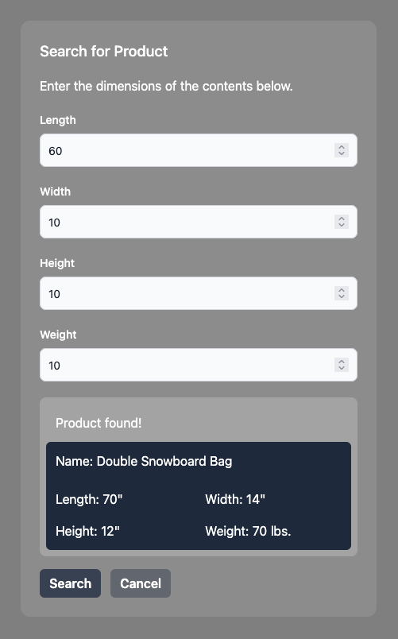

# ShipSticks Ruby on Rails Challenge for Sage Digital



## Description
Simple app that uses graphql to query for a suitable product for given content dimensions. It will return the smallest overall product that will contain the given measurements.

## Installation
Please have docker installed to run app with a single command.

## Running the app
With docker installed, docker-compose up should be all you need to run the app.
```bash
# development
$ docker-compose up -d
```

This will launch three containers (the rails api app, mongodb instance, and the vite dev server) in the default local ports (3000, 27107 and 3036 respectively). If you receive an error, make sure you don't have some other service running on one of these default ports.

## First Use
In order to prep your db with relevant information, you'll want to run the product import rake command.

```bash
$ bin/dcexec rails import:products_json
```

This will provide both `Product` and `ProductType` data for you to begin with.

## See it in Action
Access the home page at http://localhost:3000.

After opening the modal, entering in positive integers for each of the dimensional fields and then pressing `Search` will query the database for the most effective product at containing contents of the given dimensions. The modal will display information about the product that matches closest or a message if one isn't found to contain the content dimensions. Closing the modal resets the form.

## Development
The app makes use of the Windi CSS library, whose docs are [here](https://windicss.org/guide/). Importantly, this library is interoperable with [Tailwind CSS](https://tailwindcss.com/docs/utility-first) utility classes.

In addition, React state is handled exclusively via [Zustand](https://github.com/pmndrs/zustand).

Creating new products is best accomplished via the rails console.

```bash
$ bin/dcexec rails console

irb(main):001:0> Product.new(name: "Test Product")
# Products validate presence of all dimensions as well as uniqueness of name.
```
